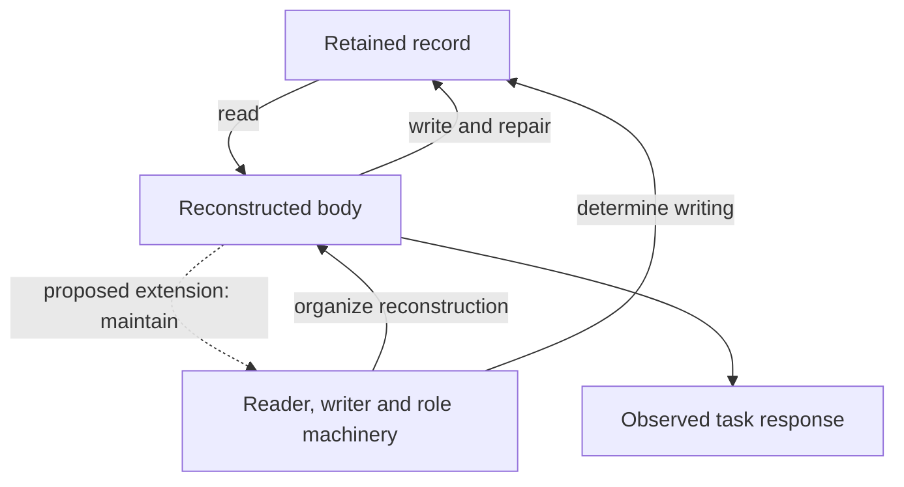

I’ve drafted an ambitious candidate theory and prepared the start instructions for two lanes: **`theory`** and, later, **`theory-tests`**.

The working name is **Reconstructive Dynamics Theory — RDT**.

Its central claim is:

> **Forms become inheritable when reconstruction corrects damaging variation while preserving acquired distinctions. Inherited adaptability can emerge when this selective restoration extends to the machinery of reconstruction itself.**

The deepest prediction is that a lineage can inherit **the ability to become competent again**: to rebuild its readers, writers and functional relationships, and then find a new solution when circumstances change.

That gives us a theory with substantial reach—acquisition, memory, repair, inheritance, development and collective organization—and a concrete way to test whether the proposed unification explains more than its component ideas.

I’ve prepared four files:

- reconstructive_dynamics_theory_v0_1.pdf[reconstructive_dynamics_theory_v0_1.pdf](sandbox:/workspace/scratch/ed624ea6970c/output/theory/reconstructive_dynamics_theory_v0_1.pdf) — the **18-page theory brief**, including the mathematical core, counterexamples, prior art and experimental programme.
- theory_lane_start.txt[theory_lane_start.txt](sandbox:/workspace/scratch/ed624ea6970c/output/theory/theory_lane_start.txt) — the ready-to-use starting instructions for the Theory agent.
- theory_test_lane_start.txt[theory_test_lane_start.txt](sandbox:/workspace/scratch/ed624ea6970c/output/theory/theory_test_lane_start.txt) — the charter for the later experimental agent.
- reconstructive_dynamics_predictions_v0_1.json[reconstructive_dynamics_predictions_v0_1.json](sandbox:/workspace/scratch/ed624ea6970c/output/theory/reconstructive_dynamics_predictions_v0_1.json) — eight structured prediction cards, including assumptions, competing explanations, calibration requirements and disconfirming outcomes.

:chatgpt-content-reference{index="8"}

## 1. The central move: explain the process that makes a successor possible

V0.16 gives this lane a clear starting point. Section 2.2 defines conditional reconstructibility; §6.3 asks for a theory that predicts which distinctions survive before observing descendants; and §6.4 identifies the larger missing connection between acquired competence, durable inheritance and flexible collective organization. Those are the three problems RDT should try to solve together. where-do-forms-come-from-zenodo-v0.16.pdf

The central object should be **the complete reconstruction process**.

A record matters because something can read it. A body matters because it can express a function and perhaps repair or rewrite the record. A reader or writer matters because it establishes the relationship between retained state and reconstructed organization.

This means that inheritance can depend on a relationship among several things:

The dashed arrow is the ambitious step: **the expressed organization maintains the task-specific machinery needed to reconstruct its successors.**

This immediately suggests a progression in what can be inherited:

| Level | What continues |
|---|---|
| Retained state | A particular distinction survives. |
| Reconstructible form | A successor can express that distinction appropriately. |
| Reconstructible competence | A successor can perform a useful function. |
| Maintained reconstruction machinery | The lineage preserves the relationship between content and its interpretation. |
| Inherited adaptability | Successors retain the capacity to discover a new functional organization after disruption. |

These levels need separate tests. Progress through them would make the programme substantially more ambitious than demonstrating increasingly long retention of a fixed response.

The earlier *Plastic Heredity* distinction also acquires a possible causal explanation here. A resemblance can disappear while the organization needed for its later return remains recoverable. The theory’s job is to identify that organization and forecast its consequences.

## 2. The mathematical core

I would start with a boundary state

\[
Z_g=(R_g,M_g,P_g),
\]

where:

- \(R_g\) is the retained record.
- \(M_g\) is mutable reader, writer, calibration and maintenance machinery.
- \(P_g\) is any other persistent body, collective or environmental state that carries relevant history across the boundary.

The important requirement is completeness for the prediction being made. In a packet-transfer assay, \(Z_g\) may consist only of the packet, with a fixed reader outside it. In a cellular handover, continuing cells and their regulatory states may be part of \(Z_g\).

A complete renewal cycle is then

\[
Z_{g+1}\sim K_{\mathcal A,\mathcal D,u_g}(\,\cdot\mid Z_g),
\]

where the apparatus, disturbance process and intervention are explicit.

Let \(q_m(z)\) be the probability that a fresh readout from state \(z\) expresses the declared form or function \(m\). Under a fixed cycle, reconstructibility is

\[
C_H(z,m)
=
\mathbb E[q_m(Z_H)\mid Z_0=z].
\]

This separates two questions:

**What can the system express now?** That is a property of the current state and its readout.

**What will its descendants be able to reconstruct?** That depends on how the complete cycle transforms the state.

A good theory should explain why those answers sometimes diverge.

For example, two bodies might both pass the current cue-response test. One may leave behind a record whose useful relationships survive further damage; the other may leave a record close to irreversible failure. Conversely, a body can fail the current readout while retaining the state required for later recovery.

The mathematical representation itself is straightforward. **The scientific wager is that a compact, measurable description of this cycle predicts future outcomes without requiring us to simulate or fit every future case.**

### The key mechanism: selective stability

The theory needs two kinds of stability.

First, the system must correct disturbances that threaten its organization. Second, it must preserve distinctions between alternative acquired forms.

Those requirements can conflict.

A reconstruction process that sends every founder to the same beautiful, stable prototype has excellent canonical reconstruction and no founder-specific memory. A process that preserves every microscopic difference may retain history while failing to produce a usable body.

RDT therefore proposes **selective restoration**:

> Correct changes that destroy the consequential organization; preserve distinctions that carry acquired identity; permit implementation changes that leave competence intact.

A simple conditional model makes the idea quantitative. Suppose error from the correct form class obeys

\[
e_{g+1}\leq \alpha e_g+\sigma,
\qquad 0\leq\alpha<1.
\]

Here \(\alpha\) measures residual error after renewal, and \(\sigma\) bounds new disturbance. If the correct identity has a safe region of radius \(r\), then

\[
\alpha r+\sigma\leq r
\]

is sufficient to keep the process within that region, provided the bound holds throughout it and the initial state starts inside it.

This yields three interpretable quantities:

- **Restoration:** how strongly a complete cycle corrects relevant errors.
- **Identity margin:** how far the system is from losing the particular distinction.
- **Disturbance load:** how much error the next cycle introduces, and in which directions.

The inequality uses standard stability mathematics. The proposed empirical advance is to estimate useful versions of these quantities from short probes and use them to forecast unfamiliar damage, longer horizons and altered machinery.

Real systems will often need more than this scalar model. Directional amplification, rare escapes and changing machinery matter. The brief includes those qualifications, including why stable eigenvalues alone can miss a damaging transient.

## 3. What the theory says about the origin of forms

The theory should distinguish **discovering a form**, **making it accessible**, and **making it inheritable**.

An experience can put the system into a previously unvisited region of its dynamics. It can also change the effective dynamics by altering connections, calibration, role assignments or the reader–writer relationship.

That gives us two acquisition mechanisms:

1. **Access changes:** the system reaches a reconstructible organization already supported by its current machinery.
2. **Organization changes:** experience alters the machinery so that a new competence becomes stably accessible in subsequent reconstruction.

Both occur within the encompassing physical or computational laws. The meaningful question is what experience changes in the effective organization.

The ambitious prediction is that useful acquisition becomes durable when it changes the reconstruction process in a way that preserves the acquired distinction through future replacement.

This suggests a stronger acquisition assay than simply observing a novel-looking state:

- Characterize the relevant reconstruction behaviour before experience.
- Let the system acquire something useful.
- Measure which relationships changed.
- Predict the consequences of removing or altering those relationships.
- Replace the original embodiment.
- Test whether the new competence—and the predicted dependence on those relationships—survives.

That would connect the origin of a competence to the mechanism of its inheritance in one system.

### An essential information constraint

If all founder-correlated information is included in \(Z_g\), and no additional founder-correlated input arrives, then reconstruction cannot create new information about an unknown founder history \(F\):

\[
I(F;Z_{g+1}\mid S)
\leq
I(F;Z_g\mid S),
\]

where \(S\) is the appropriately specified shared apparatus.

This does not prevent repair. A body may contain information missing from the damaged record. Redundancy may make surviving information usable again. A better reader may improve performance.

It does mean that the theory must identify the information sources. Improving expression and increasing ancestral information are different achievements.

This is particularly useful for your programme because it turns “the body repairs the record” into a stronger question: **which historically specific content does the body contribute, and can we predict what enters the successor?**

## 4. Three ambitious extensions

### A. Forms should transfer between compatible reconstruction processes

If two embodiments implement the same consequential organization, a translation between them should preserve more than their initial output.

The proposed criterion is:

**Translate, then reconstruct** should approximately agree with **reconstruct, then translate**.

This is much stronger than getting one successful response after transfer.

A mapping that makes two bodies look similar could fail as soon as the recipient must rewrite its own record. A mapping that preserves the reconstruction relationship should support repeated transfers, new disturbances and continued identity.

The prediction is that short tests of this compatibility will forecast which translations remain effective over longer chains.

This offers a precise route toward talking about a form across different implementations. The form’s identity is grounded in declared functional consequences and reconstruction behaviour.

### B. Collective stability should depend on how errors propagate

More communication will not always improve collective continuation.

Two individually restorative components can amplify one another’s errors. Preparation can change those gains, making communication useful at one time and harmful at another.

The theory should therefore measure how a disturbance in one member changes the relevant state of another, rather than using communication amount as its main explanatory variable.

A simple two-module model in the brief provides a conditional stability threshold. The interesting test is whether measurements of those gains forecast:

- which collective configurations remain reconstructible;
- which perturbations spread;
- when a preparation interval helps;
- why equal-duration pauses at different times have different effects.

That is a candidate mechanism for the cellular timing results. Its value would come from predicting new schedules before seeing them.

### C. The machinery of inheritance can become inherited and maintained

This is where I would place the largest long-term effort.

Progressively make task-specific support vulnerable:

- learned reader calibration;
- writer alignment;
- mappings between inputs, internal roles and outputs;
- communication relationships;
- preparation and repair policies.

Then ask whether the lineage can restore the relationships that make its records meaningful.

The theory predicts that, in some regimes, protecting additional record content will give diminishing returns because interpretation or renewal has become the limiting factor. Maintaining content and machinery together should then be worth its added cost.

It also needs to predict regimes where that investment is unnecessary or too expensive.

A protected external decoder remains a strong comparator. The goal is to understand when a lineage benefits from maintaining more of its own reconstruction process, and whether that capacity can itself change through acquisition and selection.

## 5. The eight predictions I would give the experimental lane

The registry contains complete draft cards. These are **candidate commitments**, with numerical forecasts and useful-effect thresholds to be derived from development evidence and frozen before evaluation.

### RDT-P01 — Short probes predict long lineages

**Prediction:** A compact reconstruction model derived from a limited short-probe budget predicts long-horizon expression and historical specificity in new conditions better than strong alternatives, or reaches equivalent accuracy with less calibration.

Compare it with starting performance, record fidelity, simple survival or Markov models, conventional stability measures and a flexible state-space predictor given the same observations.

**What would damage the theory:** Each new apparatus or disturbance regime requires a separate outcome-dependent fit. That would undermine the central claim of a transferable explanation.

This is the first test I would prioritize.

### RDT-P02 — Similar current performance conceals predictably different futures

**Prediction:** Among systems matched for current expression and strong conventional summaries, a specified reconstruction variable predicts later divergence.

The strongest version includes an intervention that changes that variable while preserving the matched current-performance criterion.

**What would damage the theory:** The difference disappears under fair matching, is explained by a simpler variable, or depends on undeclared state.

This must go beyond showing that a coarse phenotype label omits information. The theory must identify an economical, consequential state description.

### RDT-P03 — A forecastable damage–renewal–resource boundary exists

**Prediction:** Measured restoration, identity margin and disturbance response forecast the region in which a competence survives as damage, renewal time and resources change.

Include bursts of damage as well as dispersed loss. The same cumulative damage can have different effects if one schedule allows restoration between injuries and another does not.

**What would damage the theory:** The boundary repeatedly misses untouched conditions, or the apparent common relationship requires choosing new axes after seeing each system’s outcomes.

A rigorous sufficient bound and an empirical phase-boundary forecast should receive different verdicts when they fail to apply.

### RDT-P04 — Unseen intervention combinations can be predicted

**Prediction:** Individual intervention measurements allow quantitative forecasts of new combinations and their order.

Examples include damage followed by rewriting versus rewriting followed by damage; writer displacement combined with decoder changes; or preparation combined with communication pauses.

An optional subtest examines repeated transfers between embodiments using translations chosen for reconstruction compatibility.

**What would damage the theory:** Combined outcomes must be fitted separately, predicted order effects have the wrong direction, or simpler composition rules perform equally well.

The novelty is prospective composition, rather than the observation that a nonlinear system can have order effects.

### RDT-P05 — Complementary body and record information has predictable effects

**Prediction:** When a surviving body contains historical content missing from a damaged record, controlled changes to that content produce predictable changes in the successor record and fresh-body expression.

Use larger randomized message families. Place some distinctions only in the body, some only in the record and some redundantly in both. Cross bodies and records from different histories.

**What would damage the theory:** The benefit comes entirely from generic writing competence, shared bias or a supplied template. The stronger source-specific claim would then remain unsupported.

This would make reciprocal repair an unusually informative mechanistic experiment.

### RDT-P06 — Selective stabilization supports a larger inherited repertoire

**Prediction:** In a declared structured task family, selective stabilization supports retained old competence and new compositions better than equally costly indiscriminate stabilization.

Reserve input combinations and compositions that are not rehearsed during renewal. Compare against associative storage, replay, recurrent learning and conventional protected memory.

**What would damage the theory:** The advantage depends on hidden rehearsal, larger resource budgets, supplied solution structure or loss of earlier competence.

This is the first major bridge from retaining a taught response to inheriting something more flexible.

### RDT-P07 — Joint maintenance becomes valuable when interpretation also turns over

**Prediction:** The theory can identify regimes where maintaining the content–interpretation relationship provides a resource-adjusted continuation advantage over additional content protection alone.

Compare content protection, protected external machinery, separately renewed content and machinery, and joint maintenance. Apply the declared loss process to the relevant mutable support.

**What would damage the theory:** A task-specific rescue mechanism remains outside the accounting, conventional protection explains the advantage, or the predicted favourable and unfavourable regimes do not appear.

This is the most direct test of the stronger reconstruction claim.

### RDT-P08 — The theory chooses better repairs

**Prediction:** With a fixed observation and intervention budget, a frozen RDT policy chooses actions that improve a declared costed outcome.

Possible actions include reconnecting components, changing a pause, replacing machinery, copying, rewriting or doing nothing. Compare strong heuristics, learned selectors and ordinary model-based control.

**What would damage the theory:** Forecast improvements do not produce better decisions, or the apparent benefit disappears when extra observations, time and repair costs are counted.

This can run as soon as the theory supplies actionable choices. It need not wait for the most ambitious architecture.

## 6. The flagship experiment: inherit the capacity to adapt again

The experiment I would ultimately organize the programme around is:

> **A system acquires a useful competence, reconstructs itself through replacement of its original components and task-specific machinery, and retains the ability to discover a new compensatory organization when faced with an unfamiliar disruption.**

A concrete progression would be:

1. **Create a structured problem environment.** Specify useful consequences or resource constraints, while leaving the exact solution out of the writer and target clamps.
2. **Allow acquisition.** The system discovers a competence and changes its retained state or effective organization.
3. **Replace the original implementation.** Turn over the original components, including a declared portion of learned interpretation and renewal machinery.
4. **Test retained competence.** Establish what survived and what resources or external supports made that possible.
5. **Introduce an unfamiliar failure.** Require a different route, role allocation or compensatory organization.
6. **Test adaptation and further inheritance.** Measure whether descendants can solve the new problem and whether that ability remains available after another reconstruction.

The important outcome is a conjunction:

- old competence remains usable;
- new compensation is possible;
- the original material implementation is gone;
- the result survives fair information and resource accounting.

A system might preserve a skill yet lose the ability to repair it. Another might keep learning new things while forgetting old competence. The stronger theory predicts when both can continue together.

This gives the programme a demanding target: **inherited adaptability under reconstruction**. A finite successful experiment would establish a finite result, but it would directly address the missing connection identified in v0.16.

## 7. Where the scientific novelty would come from

There is substantial nearby work, and the Theory lane should build with it.

| Existing foundation | What RDT would need to add |
|---|---|
| **Developmental memory and natural induction** connect learned or evolved interaction structure with recall, generalization and adaptive organization. | A predictive account of which acquired competencies survive repeated reconstruction, including changes to the supporting machinery. |
| **Evolved error correction and modularity** connect robustness with further adaptation. | Forecasts of when reconstruction preserves useful variation, erases distinctions or enables inherited adaptability. |
| **Computational mechanics** develops predictive state representations. | A tractable interventional representation that transfers across the relevant reconstruction apparatuses. |
| **Semantic and organizational closure** address maintained interpreters and mutually maintained constraints. | Quantitative predictions about specified machinery surviving damage and turnover while carrying acquired competence. |

Developmental memory and natural induction are particularly close to the proposed acquisition mechanism. Watson and colleagues’ work, including the later treatment of natural induction and selection, should be central reading for this lane. [PubMed](https://pubmed.ncbi.nlm.nih.gov/24351058/?utm_source=chatgpt.com)

McCourt, Fiete and Chuang already connect evolved error correction, modularity and evolvability; that connection cannot be claimed as an RDT discovery. Computational mechanics likewise provides an established foundation for grouping histories by their predictive consequences. [arxiv.org](https://arxiv.org/html/2303.14448v2?utm_source=chatgpt.com)

The interpretation machinery also has direct precedents: Clark, Hickinbotham and Stepney demonstrate evolving descriptions, copying and constructing machinery in artificial chemistry, while Montévil and Mossio develop closure of mutually maintained constraints. [www-users.york.ac.uk](https://www-users.york.ac.uk/~ss44/bib/ss/nonstd/jrsif17.htm?utm_source=chatgpt.com)

The proposed advance is therefore **quantitative predictive compression across these phenomena**.

A restricted theory that identifies which measurements matter, predicts untouched interventions and transfers across different systems would be valuable. It would earn its breadth through results.

## 8. How I would run the two lanes

### `theory`: derive, connect and challenge

Give this agent the brief, the prediction registry, v0.16 and *Plastic Heredity*.

Its first checkpoint should be a concrete package containing:

- a precise state and information boundary for each model;
- one strongest candidate predictive relationship;
- a derivation or calibrated approximation;
- the assumptions under which it should work;
- a minimal counterexample showing where it fails;
- strong competing models;
- quantitative predictions for an untouched experimental condition.

The charter permits inexpensive toy models and development calculations. Its purpose is to turn the broad conjecture into a restricted theory that makes risky commitments.

It should maintain separate records of established mathematics, proposed empirical laws and longer-term conjectures. A result showing that part of RDT reduces to existing theory is useful: it tells us where the actual scientific work remains.

### `theory-tests`: evaluate the frozen commitments

This lane should receive a versioned theory and complete prediction specification. It should independently implement or audit the assays where practical, tune serious comparators fairly and preserve every failed prediction.

The most important operational rule is a **programme-wide record of which outcomes have been seen**. Separate lanes in a shared programme are useful procedural separation; they are not independent external replication.

For the E041 work already running, the rule is straightforward: use it as development evidence unless an exact prediction was genuinely fixed before the relevant outcomes became available. Its results can strengthen the next theory version without being retrospectively presented as confirmation.

I would begin with **P01–P04**, add **P08** when the forecasts support decisions, and use those results to determine how to build the larger repertoire and machinery-turnover experiments.

**The first Theory-lane assignment should be: derive a short-probe predictor of long-run reconstructibility that distinguishes restoration from identity loss, state where it should fail, and freeze predictions for a new intervention combination.** That creates an immediate test of the core while keeping inherited adaptability as the programme’s ambitious destination.
